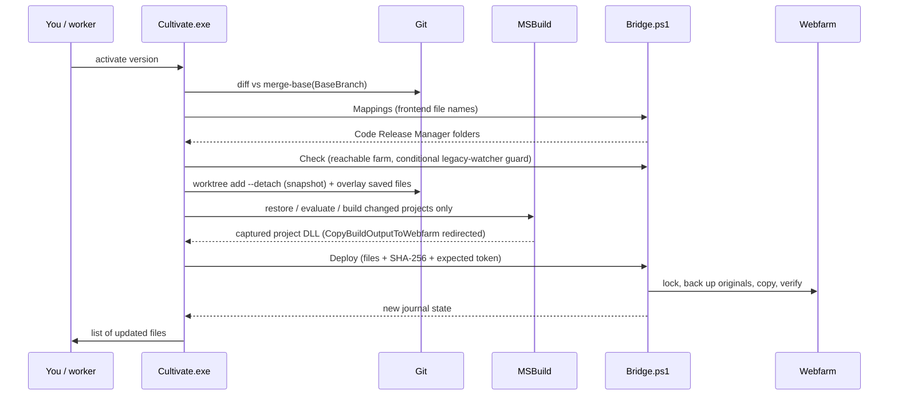

# How Cultivate updates the webfarm

Cultivate selects a MyMeyer version, snapshots its saved source, builds only projects with compiled
changes, and publishes their own DLLs alongside mapped frontend files. It keeps a local journal of the
original webfarm files so the deployment can be undone. For the user-level workflow, see
[how-it-works.md](how-it-works.md).

This reference follows the current implementation. The source links below identify where each part lives.

## The moving parts

| Component | Where it runs | Job |
| --- | --- | --- |
| [`ProjectPlanner.cs`](../src/Cultivate/ProjectPlanner.cs), [`GitRepository.cs`](../src/Cultivate/GitRepository.cs) | `Cultivate.exe`, .NET 10 | Identify changes, resolve frontend destinations, select projects, and snapshot saved source. |
| [`Pipeline.cs`](../src/Cultivate/Pipeline.cs), [`Artifacts.cs`](../src/Cultivate/Artifacts.cs) | `Cultivate.exe` | Prepare references, run MSBuild, validate outputs, and assemble the deployment payload. |
| [`Bridge.cs`](../src/Cultivate/Bridge.cs), [`Bridge.ps1`](../src/Cultivate/Runtime/Bridge.ps1) | C# caller and a new Windows PowerShell 5.1 process per call | Exchange JSON, look up mappings, validate requests, and coordinate publishing. |
| [`Cultivate.Journal.psm1`](../src/Cultivate/Runtime/Cultivate.Journal.psm1) | Inside the bridge process | Lock the destination, journal originals, back up files, copy, verify, and restore. |
| [`Cultivate.Build.targets`](../src/Cultivate/Runtime/Cultivate.Build.targets) | MSBuild under the installing Windows user | Redirect the existing MyMeyer Debug copy target to a throwaway local folder. |
| [`Capture.targets`](../src/Cultivate/Runtime/Capture.targets) | Cultivate's MSBuild runs | Capture the project's own `TargetPath` DLL after the existing copy target. |
| [`Watcher.cs`](../src/Cultivate/Watcher.cs) | Hidden background `Cultivate.exe watch` | Poll the source and re-run the pipeline when saved content changes. |

`Cultivate.exe` never writes to the webfarm itself. It hands a fully built, hashed file list to the bridge,
and the bridge journals and copies it through the PowerShell module. The journal format is the same one the
original WebfarmWorkspace utility used.

### How this relates to WebfarmFileSync

Cultivate does **not** invoke `WebfarmFileSync.exe` or ask that watcher to copy files. It uses the existing
Code Release Manager file mappings to implement its own file sync. Frontend files go through the same
journal, backups, and verification as compiled DLLs. A frontend-only activation needs the mapping lookup,
snapshot, and publish steps, but no MSBuild invocation.

The two existing ways of updating the farm are handled separately:

- **Saved frontend files:** Cultivate replaces the legacy watcher with its own worker. It maps file names
  through `MY_CodeRelease_WebfarmFiles` and publishes the selected version's saved contents.
- **Project DLLs:** Cultivate runs the project's existing `CopyBuildOutputToWebfarm` target, redirects its
  direct copy locally, captures the project's output, and publishes it through the journal.

Running the legacy watcher alongside Cultivate could overwrite that selected version. The bridge checks
for it before preparation and again before publishing; the exact scope of that check is described under
[the Check action](#the-check-action).

### Settings and directories

[`Models.cs`](../src/Cultivate/Models.cs) defines settings and defaults. `cultivate config` prints the
effective values and settings file path. Settings normally live in
`%LOCALAPPDATA%\Meyer\Cultivate\settings.json`; `CULTIVATE_HOME` overrides the data directory.

| Setting or directory | Meaning and default |
| --- | --- |
| `RepositoryRoot` | Normal MyMeyer checkout, also used as a dependency cache. Auto-discovery tries `Documents\GitHub\MyMeyer`; it must contain `MyMeyer.sln`. |
| `BaseBranch` | Local comparison baseline, normally `master`. It is not fetched automatically. |
| `WebfarmRoot` | Absolute root of the development site, **above** `bin`, for example `\\webfarm-dev02\C$\inetpub\MyMeyer`. Suggested from the user-scoped `WebfarmPath`, then the process environment. |
| `MappingAssembly` | Normally `<RepositoryRoot>\bin\MeyerObjects.dll`; supplies the Code Release Manager connection string. Required when frontend mappings are needed. |
| `MSBuild` | Visual Studio `MSBuild.exe`, discovered with `vswhere` if not configured. This builds MyMeyer projects, independently of Cultivate's .NET 10 runtime. |
| `WatchSavedFiles` | Default `true`; determines whether activation starts a worker unless the caller disables it. |
| `StateRoot` | Journal, locks, and original-file backups. Reuses `%LOCALAPPDATA%\Meyer\WebfarmWorkspace` if that directory exists; otherwise defaults to `<data directory>\State`. A saved explicit value takes precedence. |
| Program directory | Installed by [`install.ps1`](../scripts/install.ps1) to `%LOCALAPPDATA%\Programs\Cultivate` by default. The PowerShell and targets files remain beside `Cultivate.exe`. |
| Data directory | `%LOCALAPPDATA%\Meyer\Cultivate`, or `CULTIVATE_HOME`: settings, `Runs`, `Requests`, `Workers`, `Logs`, and `Staging`. Changing this does not relocate an explicitly configured `StateRoot`. |

If no settings file exists, Cultivate also reads repository and mapping-assembly suggestions from
`WebfarmWorkspace\App\settings.json`. It does not migrate or delete the existing deployment backups.



## 1. Working out what changed

`GitRepository.Inspect` defines the change set for a target. A target is either a worktree (its saved files
on disk) or a branch ref (committed contents only).

1. A worktree with merge conflicts is refused. An attached worktree must still be on its selected branch;
   a detached worktree must still be at its selected commit. New commits on the same attached branch are
   allowed and change the fingerprint.
2. The baseline is `git merge-base <commit> <BaseBranch>`.
3. The changed paths are `git diff --name-only --no-renames <baseline>` (for a worktree, compared against
   the working tree) or `<baseline> <commit>` (for a branch). A worktree also adds untracked, non-ignored
   files (`git ls-files --others --exclude-standard`).
4. A **fingerprint** is a SHA-256 over the commit plus each path and its content identifier: the file's
   SHA-256 on disk, or the `git ls-tree` result for a branch. Worktree deletions use `(deleted)`; branch
   deletions have an empty tree lookup result.

Cultivate checks the fingerprint again after the snapshot and immediately before publishing. A mismatch
aborts that activation before any webfarm changes. The worker also compares fingerprints on later polls.
These are checks at specific points, not a lock on editors or Git operations.

Branch targets resolve local or cached remote refs without checking out a user's worktree. Cultivate does
not fetch, pull, commit, or push the MyMeyer source. Deploying `BaseBranch` itself, including its matching
remote branch, is refused.

## 2. Planning: the file sync side

`Planner.Create` sorts every changed path into one of three kinds.

### Frontend files (copied as-is)

Files with a frontend extension (`.ascx .aspx .css .js .html .htm`, images, and fonts) that aren't under a
`bin`, `obj`, `packages`, `.git`, or `Backup` folder.

The destination comes from **Code Release Manager**, the same table the existing release process uses. The
bridge's `Mappings` action loads `MappingAssembly` (normally `MyMeyer\bin\MeyerObjects.dll`) to read the
`MeyerLogicAoConnectionString`. It then runs this for each distinct file name, caching the results per call:

```sql
SELECT FilePath FROM MEYER..MY_CodeRelease_WebfarmFiles WITH (NOLOCK) WHERE FileName = @FileName
```

- If there is exactly one `FilePath`, the destination is `<FilePath>\<FileName>`, relative to `WebfarmRoot`.
- If there are no rows, the plan error is "No Code Release Manager destination".
- If there are several distinct folders, mapping lookup fails with "Ambiguous Code Release Manager mapping".
- If two changed sources resolve to the same destination, the plan error is "Multiple source files map
  to".

The lookup is **by file name only**. The source checkout folder does not determine the webfarm folder;
each name must resolve to one distinct destination folder. Duplicate rows with the same `FilePath` are
deduplicated. Empty mappings are rejected, and rooted or escaping destination paths are refused. Cultivate
reads this table but does not add or update mappings. A deleted frontend file becomes a delete action at
its mapped destination. A rename is treated as a deletion and an addition, so both names need mappings.

### Compiled inputs (built, never copied)

`.cs`, `.resx`, `.csproj`, `.props`, `.targets`, and `packages.config`. These are never copied to the
webfarm. They select which projects to build (see below).

### Everything else

SQL, configuration, solution files, documentation, and tracked DLLs are counted in a note and ignored. No
database scripts run.

### Choosing projects to build

Candidate projects are every `*.csproj` in the selected source whose text contains
`CopyBuildOutputToWebfarm`. For a branch target, that source is a temporary detached worktree of the commit,
so the catalog reflects that branch rather than the normal checkout. A project **owns** a change when:

- the change is the `.csproj` itself,
- it is a `packages.config` in the project's folder,
- it is listed as a `Compile`, `EmbeddedResource`, or literal `Import` item, or
- it was deleted from inside the project's folder while that `.csproj` also changed.

`Planner.BuildOrder` collects the owners into a set, so **each project is built once** however many of its
files changed. It then orders the set by `ProjectReference` and by assembly references between owners, and
rejects dependency cycles. A compiled change that no project owns is a plan error. It never widens into a
solution build. Unchanged dependencies and consumers are never added.

The plan also gets a **build fingerprint**: a SHA-256 of a format marker, the commit, the MSBuild path, and
the paths and contents of every compiled change. The worker uses it to decide whether active DLLs can be
reused. A new commit changes this fingerprint even if that commit only changes frontend files.
It is not a complete dependency hash: existing reference DLLs and installed capture/bridge files are not
included, and changing those alone does not trigger the source worker.

## 3. Snapshot

`GitRepository.Snapshot` creates `Runs\<run-id>\source` with `git worktree add --detach <commit>` from
`RepositoryRoot`. For a worktree target, it then copies every file that differs from that commit, plus
untracked files, and removes deleted ones. The result contains the selected commit with saved changes
overlaid; ignored package and build caches are prepared separately. Your selected worktree is never
checked out, built in, or modified by activation.

If the fingerprint changed during the copy, the snapshot is discarded. The snapshot worktree is always
removed with `git worktree remove --force` when the run ends normally or unwinds through an exception.
The run's logs and verified DLL cache remain. A forced process termination can leave the temporary
worktree behind; `WorkspaceRoot` in the journal is a recorded snapshot path, not a permanent source cache.

## 4. Building: the MSBuild side

`Pipeline.Build` runs Visual Studio's `MSBuild.exe` once per changed project, in build order. Every MSBuild
call gets these environment variables, which MSBuild reads as properties:

| Variable | Value | Purpose |
| --- | --- | --- |
| `CultivateRunDirectory` | `Runs\<run-id>` | Marks the build as Cultivate's and turns on capture. |
| `CultivateCaptureTargets` | `<install>\Capture.targets` | Imported by the per-user hook. |
| `WebfarmPath` | `Runs\<run-id>\intercepted\` | A safety net: even without the redirect, the project's copy stays local. |
| `ReferencePath` | `Runs\<run-id>\references` | The folder of reference DLLs seeded for this run. |

### 4a. Preparing references (`Pipeline.Prepare`)

Ignored package and build caches are absent from a fresh snapshot; tracked files remain part of the
checkout. Cultivate prepares the inputs for each changed project as follows:

1. **Package folders.** For every literal `HintPath` or `Import` under `packages\`, Cultivate copies that
   package folder from the selected worktree, or else from the normal checkout, into the snapshot's
   `packages`.
2. **Restore if needed.** If a package is still missing, Cultivate runs
   `MSBuild <project> -t:Restore -p:RestorePackagesConfig=true -p:SolutionDir=<snapshot>\` using your
   existing NuGet feeds and credentials. The output goes to `restore.log`.
3. **Resolve literal HintPaths** (entries containing MSBuild property expressions are skipped by this
   preparation code):
   - **Package HintPaths** that exist in the snapshot are used there directly. They are not copied to
     `references`. If one is still missing, because the HintPath names a version
     that `packages.config` never restores, Cultivate falls back to `bin\<name>` in the worktree, then in the
     normal checkout. It accepts that file only when its assembly version exactly equals the `Version=` in the
     `<Reference Include>`. Otherwise the build stops. Cultivate never substitutes a GAC or Visual Studio
     DLL.
   - **Other HintPaths** (sibling repositories, `..\..\bin\MeyerObjects.dll`, and so on) are looked up in
     order: the snapshot, the selected worktree, the normal checkout, then `bin\<name>` in the worktree and
     in the checkout.
   - Non-package HintPaths and accepted package fallbacks are copied to `references`. References whose
     DLL name matches another project in this build are skipped here; build ordering makes its fresh
     output available to dependent projects.
   - If two different files with the same name would be seeded, the build stops. Every seed's source is
     written to `build.log`.

### 4b. Evaluating before building

Before each build, Cultivate evaluates the project with
`-getProperty:TargetPath,_CultivateCaptureReady -getItem:Compile,EmbeddedResource,ProjectReference`.

- `_CultivateCaptureReady` must be `true`. This proves the per-user hook imported `Capture.targets`. Without
  it the build stops and tells you to rerun `install.ps1`.
- Every changed `.cs` or `.resx` the project owns must appear in its evaluated `Compile` or
  `EmbeddedResource` items in Debug. Otherwise "MSBuild does not compile X" stops the deployment, instead of
  shipping a DLL without your change.
- Each `ProjectReference` to an **unchanged** project must already have its `TargetPath` DLL, unless it
  explicitly has `ReferenceOutputAssembly=false`. If it's missing
  from the snapshot, Cultivate copies it from the worktree or the checkout. If it's missing there too, the
  build stops. Unchanged projects are never rebuilt.

### 4c. The build

```text
MSBuild <snapshot>\<project>.csproj -t:Build -p:Configuration=Debug -p:BuildProjectReferences=false
        -m:1 -v:minimal -bl:Runs\<run-id>\<Assembly>.binlog
```

The evaluated `TargetPath` and compiled/resource input paths must stay inside the snapshot. Cultivate
uses the project's configured output paths inside that snapshot rather than building in your checkout.
After the build, `TargetPath` must exist and its `AssemblyName` must match the project's `<AssemblyName>`.
The DLL is then copied into `references`, so the next changed project in the order compiles against the
fresh build.

### 4d. What happens to `CopyBuildOutputToWebfarm`

Cultivate discovers participating projects by the presence of `CopyBuildOutputToWebfarm` in their project
text. For example, MyMeyer's `MiscApps\MiscApps\MiscApps.csproj` declares a target shaped like this
(excerpt; its branch checks and other tasks are omitted):

```xml
<Target Name="CopyBuildOutputToWebfarm" AfterTargets="Build" Condition="'$(Configuration)' == 'Debug'">
  ...
  <Copy SourceFiles="@(TestBuildFiles)" DestinationFolder="$(WebfarmPath)bin" SkipUnchangedFiles="true" />
</Target>
```

That project target normally reads `WebfarmPath`, chooses its DLL, and copies to `$(WebfarmPath)bin` after
Build in Debug. Its own branch conditions still apply. Cultivate snapshots are detached worktrees, where
`git rev-parse --abbrev-ref HEAD` normally returns `HEAD` rather than `master`.

Cultivate doesn't edit or replace that target; it lets it run. Instead, `install.ps1` writes
`Meyer.Cultivate.targets` into both
`%LOCALAPPDATA%\Microsoft\MSBuild\{Current,15.0}\Microsoft.Common.targets\ImportAfter\`. MSBuild imports
those user extension files for builds that load `Microsoft.Common.targets` with user imports enabled.
Each hook file imports `<install>\Cultivate.Build.targets`. The redirect applies only when a
`MyMeyer.sln` is found above the project and the existing copy target runs in Debug:

1. **Guard against `/p:WebfarmPath`.** At evaluation time, the hook writes a probe value into `WebfarmPath`
   and checks that it stuck. A global `/p:WebfarmPath=` property is immutable, so the probe fails, and the
   hook errors before the Debug copy target can use that global destination.
2. **`CultivateStageWebfarmCopy`** (`BeforeTargets="CopyBuildOutputToWebfarm"`, Debug, under a
   `MyMeyer.sln`) saves `WebfarmPath` and points it at a fresh `<CULTIVATE_HOME>\Staging\<guid>\`. The
   project's `Copy` therefore lands in a local staging folder.
3. **`CultivateCaptureArtifacts`** (from `Capture.targets`, `AfterTargets="CopyBuildOutputToWebfarm"`, only
   when `CultivateRunDirectory` is set) copies `$(TargetPath)` (the project's own DLL only) to
   `Runs\<run-id>\captured\<Project>\` and writes its path to `manifests\<Project>.artifacts`.
4. **`CultivateDiscardWebfarmCopy`** (`AfterTargets="CopyBuildOutputToWebfarm"`) restores `WebfarmPath` and
   deletes the staging folder after a successful target. If MSBuild fails before cleanup runs, a local
   staging folder may remain; its contents are not a deployment payload.

This has two effects:

- **Visual Studio builds** from any worktree run the same redirect when the hook is loaded and get the
  message "this build's webfarm copy was kept local". This redirect applies even when no Cultivate
  deployment is active. Release copies and projects outside `MyMeyer.sln` are not redirected.
- **Cultivate builds** run the existing target with a local destination. Capture independently records
  `$(TargetPath)`; it does **not** enumerate `@(TestBuildFiles)` or collect whatever the original Copy task
  copied. A successful build alone does not satisfy Cultivate: the manifest and expected DLL must pass
  artifact validation before any publishing.

Capture and discard are both attached after `CopyBuildOutputToWebfarm`; capture reads `TargetPath`, so it
does not depend on keeping the discardable staging folder. The original target's "Copied" message can
refer to a **local** staging path. It is not proof of an update to the configured webfarm.

The hook only redirects copies that honor `WebfarmPath` through this target. It is not a sandbox for
arbitrary custom build tasks, hard-coded network copies, or projects that disable the user import.
Cultivate's evaluation check rejects a missing capture import. Reload open Visual Studio solutions after
installing or removing the hook.

The installer backs up recognized `Meyer.WebfarmWorkspace.targets` imports under `Migrated` and removes
them to avoid double interception. Unrecognized legacy imports are left with a warning.
[`uninstall.ps1`](../scripts/uninstall.ps1) normally refuses an active deployment; restore first. It removes
hooks belonging to that installation and keeps settings, logs, and deployment backups. Uninstalling does
not itself restore webfarm files; `-Force` explicitly leaves the deployment there.

### 4e. Collecting artifacts (`Artifacts.Collect`)

Each built project's manifest must exist and list exactly one file named `<Assembly>.dll` whose assembly
identity matches. That file is staged at `<snapshot>\.cultivate-artifacts\bin\<Assembly>.dll`, with the
webfarm destination `bin\<Assembly>.dll`. Two projects producing the same destination is an error.

Copy-local dependencies, PDBs, and the rest of `bin` are **never** published. The webfarm must already have
any API the new DLL calls.

Each published DLL is also copied to `Runs\<run-id>\verified\` with its SHA-256, as `RuntimeFiles`. A later
frontend-only update reuses those copies.

### 4f. Final source check

Cultivate inspects the target again. If its fingerprint no longer matches the plan, because a file was saved
during the build, the run stops with "The selected source changed during the build" and nothing is deployed.

## 5. Publishing: the journal

`Bridge.Call` writes a JSON request to `<CULTIVATE_HOME>\Requests\<guid>.json` and runs
`powershell.exe -NoProfile -ExecutionPolicy Bypass -File Bridge.ps1 -Action <action>`. It reads the result
from `<guid>.json.result`, and deletes both files afterwards. The actions are `Mappings`, `Status`, `Check`,
`Deploy`, `Restore`, and `Heartbeat`.

### Journal layout

Each webfarm root has its own folder under `StateRoot`. The folder name is the SHA-256 of the absolute root
path, without a trailing backslash, in upper case. This normalizes spelling, not share identity, so
`\\webfarm-dev02\C$\inetpub\MyMeyer` and a mapped drive pointing at it are **different**
destinations:

```text
<StateRoot>\<sha256(ROOT)>\
    workspace.lock     exclusive file lock, 30-second wait
    workspace.json     the journal (Version 1, shared with WebfarmWorkspace)
    <guid>.backup      the original of each file Cultivate replaced
```

`workspace.json` holds the active branch, source, fingerprints, a random **token**, `Active`, the
worker's PID and heartbeat, `RuntimeFiles`, and `Files`. Each `Files` entry has this shape:

```json
{ "RelativePath": "bin\\MiscApps.dll", "Backup": "<guid>.backup",
  "OriginalHash": "<SHA-256 before Cultivate, or null if the file didn't exist>",
  "DeployedHash": "<SHA-256 Cultivate wrote, or null for a delete>", "Source": "<snapshot path>" }
```

Every state write goes to a temporary file first and then replaces `workspace.json`, avoiding a partially
written JSON file during normal operation. Deploy, Restore, and Heartbeat use the same lock; Status reads
the journal without acquiring it. The default local `StateRoot` coordinates processes for that user on
that machine. It does not lock out another user, another computer, IIS, or an unrelated deployment tool.

### The `Check` action

`Check` runs before the activation snapshot or build. It verifies that the webfarm root is reachable. If
the **user-scoped** `WebfarmPath` environment variable normalizes to the same root, it also refuses any
`WebfarmFileSync.exe` process in the current Windows session. It does not inspect that process's actual
destination or detect another session's watcher. A process-only `WebfarmPath` value does not enable this
guard. Deploy repeats these checks before entering its publish lock. `cultivate doctor` separately warns
when it sees the legacy process.

### The `Deploy` action, step by step

Everything below runs while holding `workspace.lock`.

1. **Optimistic concurrency.** `ExpectedToken` must equal the journal's current token. If another activation,
   restore, or worker changed the farm since this run read the status, the deploy fails with "Preview again".
2. **Validate the payload.** The snapshot and the webfarm must not overlap. Every source must be inside the
   snapshot, and every destination inside the root. Neither may cross a link or junction. Destinations must
   be unique, and each file's current SHA-256 must equal the hash `Cultivate.exe` computed after the build.
3. **Switch or update in place.**
   - **New activation** (any other version, or a fresh activation of the same one): the previous version is
     marked inactive under a new token, and **all** of its files are restored to their originals first,
     except files changed outside Cultivate (see Restore). Then a new journal is started. Originals mean the
     farm files saved before Cultivate's override, not the previous development branch's files.
   - **Worker update** of the same source and ref: the journal is kept. Each existing entry's backup must still
     be intact, unless its file changed outside Cultivate. Files the new plan no longer deploys are
     restored individually inside the publish try block below.
4. **Write ahead.** The new or reused state is saved with `Active = false` and a new token before applying
   the new payload or restoring its obsolete entries. Any previous activation's restore in step 3 has
   already happened.
5. **Copy each file** (`Copy-WorkspaceFile`):
   1. Copy the source to `<guid>.upload` in the journal folder, and hash it.
   2. Hash the current destination.
   3. **If the file is already journaled,** an identical file is skipped. If the destination matches
      neither its `DeployedHash` nor its `OriginalHash`, someone changed the farm file, for example with a
      manual build. Cultivate drops that entry and its backup and treats the file as new to the journal, so
      the changed file becomes the original that a later restore returns to.
   4. **If the file is new to the journal,** back up the existing destination (if any) to `<guid>.backup`
      and record `OriginalHash`.
   5. Record the new `DeployedHash`, **save the journal**, and only then copy (or delete) the file.
   6. Hash the destination again. A mismatch is "Copy verification failed".
6. **Activate.** The state is saved with `Active = true` and returned to `Cultivate.exe`.
7. **On failure inside the publish try block,** the error is saved to `LastError` and the bridge attempts
   to restore every remaining journaled file to its original, including files from an in-place worker
   update. It rethrows the failure; it does not reactivate the previous development version. Restoration
   can itself fail because of a missing backup, permissions, or a lost share. Remaining
   entries and backups are kept for recovery. Earlier validation failures stop before this try block and
   do not trigger this rollback.

`Cultivate.exe` then builds the **deployment summary** from the payload and the previous journal. Each file
is listed as built and copied, copied (unchanged build), synced, deleted, restored to its original, or kept
(the last two for files the old version deployed that the new one doesn't).
These labels describe the payload's actions; identical content may be skipped by the bridge. The summary
is added to the activation result by C# and is not persisted as part of `workspace.json`.

### Restore

`Restore` (`Disable-WebfarmWorkspace`) takes the lock, marks the journal inactive with a new token (which
stops the worker), and restores files in two passes:

1. **Verify everything first.** Every backup must match its `OriginalHash`. Files changed outside
   Cultivate are skipped here, because their backups are not used.
2. **Restore each file.** A file whose destination matches neither its deployed nor its original hash
   changed outside Cultivate, usually from a manual build. Cultivate keeps it as is, drops its entry and
   backup, and reports it as kept (`[KEPT]` in the bridge log). For every other file, Cultivate copies
   the backup back, or deletes the file if it didn't exist before, then verifies the hash and removes the
   entry from the journal. Only after that does it delete the backup.

Because the journal format is unchanged, `cultivate restore` also undoes deployments made by the original
WebfarmWorkspace utility when configured to use the same `StateRoot` and webfarm root.

### Failure boundaries and limitations

| Failure point | Effect on the webfarm |
| --- | --- |
| Mapping, snapshot, reference preparation, restore of packages, build, or final source check | Publishing has not started. The current farm files remain as they were. |
| Expected-token or payload validation; in-place validation of existing backups | Rejected before publish changes. |
| Restoring a previous activation while switching versions | Restore verifies the entries first, then changes them one at a time. An I/O failure can leave a partial restore with journal entries retained. |
| Copying a new payload or removing obsolete files during a worker update | The bridge attempts to restore the journaled originals. The previous development deployment is not guaranteed to remain active. A failed rollback leaves recovery work recorded in the journal. |
| Worker startup after a successful deploy | Files are already deployed. A worker timeout is not a deployment rollback; inspect status before relying on automatic saves. |

Multiple SMB copies are **not atomic**. IIS can serve intermediate combinations of files and can recycle
when DLLs change. The local journal makes operations recoverable where possible; it is not a webfarm-wide
transaction. Use a development webfarm and the same UNC root and `StateRoot` for activation and recovery.
If a process is killed mid-publish, inspect the journal and restore instead of deleting state or backups.

## 6. Automatic updates (the saved-file worker)

When you choose automatic updates, `Watcher.Start` writes the settings to `Workers\<token>.json` and starts a
hidden `Cultivate.exe watch --token <token>`. It waits up to 15 seconds for that worker's first heartbeat in
the journal.

The worker waits 2 seconds between completed loop iterations; inspection and builds add to that interval:

1. **Read the journal.** The worker exits if the journal is gone, inactive, owned by another token, or not
   in Cultivate mode. This is how a new activation or a restore stops it.
2. **Send a heartbeat** (`Heartbeat` action) with its PID and the last error.
3. **Hand over after an update.** If `Cultivate.exe` was replaced by `cultivate update`, the worker starts a
   successor on the new executable and exits.
4. **Look for changes.** The worker runs `Inspect` on the source. If the fingerprint differs from the
   deployed one (and from the last failed attempt), it waits 800 ms and inspects again, so editors that save
   in several writes settle first. It then plans again and runs `Activate` with `workerUpdate: true`,
   sending heartbeats every 2 seconds during long builds.
   - If the **build fingerprint is unchanged** and the active DLLs cover exactly the planned projects, the
     update needs no new compilation. The verified DLLs in `Runs\<old-run>\verified` are hash-checked and redeployed,
     **without MSBuild**. The summary lists them as copied (unchanged build).
   - Otherwise the changed projects are rebuilt as in step 4.
   - The bridge applies the result **in place** (step 3 of Deploy), so the original backups from the first
     activation are kept for the final restore.
5. **On a handled update failure**, the error goes to `watch.log` and the heartbeat. Failures before
   publishing, such as a build error or missing mapping, leave the current deployment in place. A publish
   failure follows the rollback behavior above and may stop the worker when the deployment becomes
   inactive or its token changes. Within the same worker process, an attempted stable fingerprint is not
   retried until source content changes. A startup error, lost journal access, or unhandled exception can
   terminate the process; heartbeat and status show whether it is still running.

The worker polls Git state rather than subscribing to filesystem events. Only saved bytes are visible;
unsaved editor buffers are not. For a branch target it follows the selected local ref (including newly
committed changes or locally refreshed remote refs), not another worktree's uncommitted edits. It never
fetches the remote itself. Closing the menu does not stop the hidden worker. Stopping or losing the worker
does not restore files; Restore or a new activation changes journal ownership.

## 7. Example: markup plus code-behind

Suppose a selected development worktree changes these files relative to its merge-base with `master`:

```text
MiscApps\MiscApps\PriceGroupMatrix.ascx
MiscApps\MiscApps\PriceGroupMatrix.ascx.cs
```

Assuming the mapping table maps `PriceGroupMatrix.ascx` to `DesktopModules\PriceGroupMatrix`:

1. The markup becomes `DesktopModules\PriceGroupMatrix\PriceGroupMatrix.ascx` on the farm.
2. The code-behind belongs to `MiscApps\MiscApps\MiscApps.csproj`, so that project is built once in Debug
   in the isolated snapshot. Unchanged `MeyerObjects` and other dependencies supply existing DLLs.
3. `CopyBuildOutputToWebfarm` runs, but its destination is local staging. Capture records `MiscApps.dll`,
   and Cultivate validates it and adds `bin\MiscApps.dll` to the payload.
4. The bridge backs up and journals the two original webfarm files, then copies and verifies the two new
   files. It does not publish the `.cs` file, dependency DLLs, or PDBs.
5. A later markup-only save in the same active worktree normally reuses the verified DLL cache. The
   payload still includes that DLL, but the bridge skips its physical copy if its hash already matches.
6. A code-behind save changes the build fingerprint and rebuilds the owning project. Restore eventually
   returns both files to their pre-activation versions, or removes them if they originally did not exist.

These command examples use an already configured installation; replace the example paths and branch:

```powershell
# Inspect configuration and prerequisites, then preview without building or publishing.
cultivate config
cultivate doctor
cultivate list
cultivate plan --worktree 'C:\worktrees\12345'

# Activate the saved worktree once, without starting a saved-file worker.
cultivate activate --worktree 'C:\worktrees\12345' --yes --once

# Alternatively, activate committed branch content. Automatic updates follow WatchSavedFiles.
cultivate activate --branch '12345' --yes

# Inspect deployment state, then stop ownership and restore the journaled originals.
cultivate status
cultivate restore --yes
```

## 8. Where to look when something goes wrong

| Path (under `%LOCALAPPDATA%\Meyer\Cultivate` or `CULTIVATE_HOME`) | Contents |
| --- | --- |
| `Runs\<run-id>\plan.json` | The plan that was executed. |
| `Runs\<run-id>\build.log` | MSBuild evaluation and build output, plus the source of every seeded reference. |
| `Runs\<run-id>\restore.log` | NuGet restore output, when a restore was needed. |
| `Runs\<run-id>\<Assembly>.binlog` | MSBuild binary log for each built project. Open it with MSBuild Structured Log Viewer to see the `CopyBuildOutputToWebfarm` redirect and capture. |
| `Runs\<run-id>\captured`, `manifests`, `verified` | What the capture target recorded, and the hashed DLLs published from it. |
| `Logs\bridge-<guid>.log` | Output from each Deploy, Restore, Check, or Mappings call: `[OK]`, `[DELETED]`, `[RESTORED]`. |
| `Logs\watch.log` | Worker progress and blocked updates. |
| `Logs\last-error.log` | Exception details from a failed command. |
| `Workers\<token>.json` | Settings snapshot used by the hidden worker; later setup changes do not reconfigure that running process. |
| `<StateRoot>\<hash>\workspace.json` | The live journal. **Don't edit or delete it, or the backups beside it.** |

Run `cultivate status` for the journal as JSON, and `cultivate doctor` to check the hook, the runtime
files, the mapping assembly's presence, and access to the journal. Doctor does not prove that a mapping
query will succeed or that a new DLL's runtime dependencies are compatible with the farm. Run a plan to
exercise frontend mapping lookup. If restoration fails, retry Restore while
keeping the journal and its backups intact.
